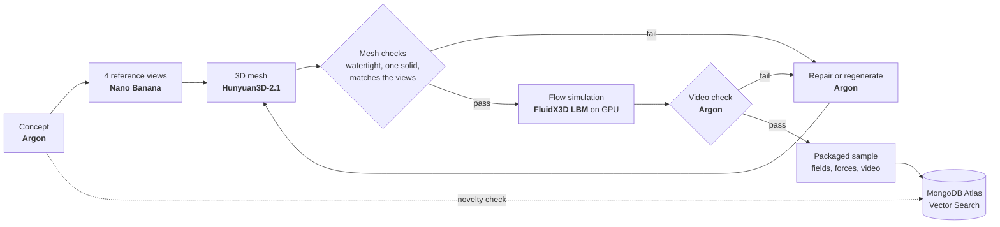

# FlowArc

**Text in, checked 3D flow simulation out. An agent that builds shape-diverse datasets for AI physics.**

Neural flow models only work on shapes like the ones they were trained on, and public datasets are narrow: DrivAerNet++ is cars only, and a dataset like it takes engineers months. FlowArc lets Gemini 4 Argon invent objects of every kind (animals, aircraft, furniture, buildings, abstract shapes), turn each into a simulation-ready 3D mesh and run a GPU flow simulation around it, checking every step and repairing what fails.

Built at **Encode London 2026** for Pathway 2 (Real World, Hard Tech & Multimodal Creation), the Google DeepMind Gemini bounty and the MongoDB Atlas bounty. All code was written during the hackathon.

**Live dashboard: [flowarc-web.vercel.app](https://flowarc-web.vercel.app)** (Home slides, Live run, Dataset with the diversity map)

## Result

The run took 12 hours. Measured as mean pairwise distance between concept embeddings, the FlowArc dataset is **4.5× more diverse** than the DrivAerNet++ design space:

| Dataset | Mean pairwise embedding distance |
|---|---|
| FlowArc | **0.388** |
| DrivAerNet++ (baseline) | 0.086 |

## Pipeline



1. **Concept.** Argon proposes an object that fills a gap in the dataset, with its flow settings. It first asks Atlas what already exists (hybrid search); a concept too close to an existing one is rejected by Vector Search.
2. **Reference views.** Nano Banana draws four consistent views. Argon checks they agree.
3. **Mesh.** Hunyuan3D-2.1 turns the views into a mesh. Automatic checks test that it is watertight, a single solid and matches the views. Argon reviews the mesh against the views and decides to repair or regenerate, using past fixes from Atlas.
4. **Simulation.** FluidX3D (lattice Boltzmann) runs on our GPUs. Forces and statistics must converge.
5. **Video and package.** A Q-criterion vortex video, checked by Argon, plus surface and volume fields, force histories and metadata.

A person can step in from the dashboard: samples that need a look can be accepted, retried or dropped.

## Gemini models

| Model | Job |
|---|---|
| `gemini-4-argon` | Concepts, view, mesh and video checks, repair decisions |
| `gemini-nano-banana-2.1` | Multi-view reference images |
| `gemini-embedding-2` | 3072-d concept embeddings for novelty, similar shapes and the diversity map |

## MongoDB Atlas

Atlas (M10) is the dataset registry and the agent's memory. GPU workers and the dashboard all read and write it.

| Feature | Used for |
|---|---|
| Vector Search | Novelty check on new concepts; "similar shapes" in the dashboard |
| Atlas Search | Keyword search and facet counts over samples, logs and repairs |
| Hybrid Search (`$rankFusion`) | Argon's `search_registry` tool, past-fix lookup for repairs, the dashboard search box |
| Automated Embedding (Voyage AI) | `voyage-4` embeds descriptions and repair diagnoses inside Atlas |
| GridFS | Views, meshes and flow videos for the dashboard |

Full sample files (Zarr fields, meshes, videos) also go to a private Hugging Face dataset; Atlas holds the record and the links.

Collections: `samples`, `logs`, `repairs`, `reviews`, `baseline` (DrivAerNet++ design-space descriptions, embedded the same way as our concepts).

## Run it

```bash
uv venv --python 3.12 && uv pip install -e '.[dev]'   # add '.[sim]' on a GPU box
cp .env.example .env                                   # GEMINI_API_KEY, MONGODB_URI
python scripts/setup_atlas.py                          # once: collections and search indexes
python scripts/run_pool.py --new 10                    # propose 10 concepts and run them, one per GPU
python -m flowarc.media --watch 5                      # copy views, meshes and videos to GridFS
pytest
```

The dashboard is in [`web/`](web/README.md).

## Layout

```
flowarc/    agent pipeline: concepts, images, mesh/, sim/, render, package, store (Atlas)
scripts/    Atlas setup, run pool, baseline seeding, solver validation
web/        dashboard (Vercel, reads Atlas)
tests/
```

## Limits

- The data is checked, not proven accurate. At high Reynolds numbers the grid does not resolve the boundary layer, so those samples record a nominal Re and their resolution.
- The baseline is DrivAerNet++'s design space described in text, not its meshes.

## Team

- **Ose** ([@Esoiya](https://github.com/Esoiya)): MongoDB Atlas memory and search, Argon repair loop, dashboard and demo
- **Harris** ([@Hrrsmjd](https://github.com/Hrrsmjd)): agent pipeline (concept to mesh to simulation), FluidX3D solver and validation
