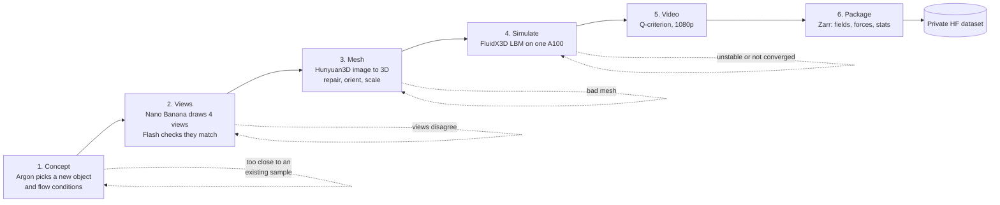
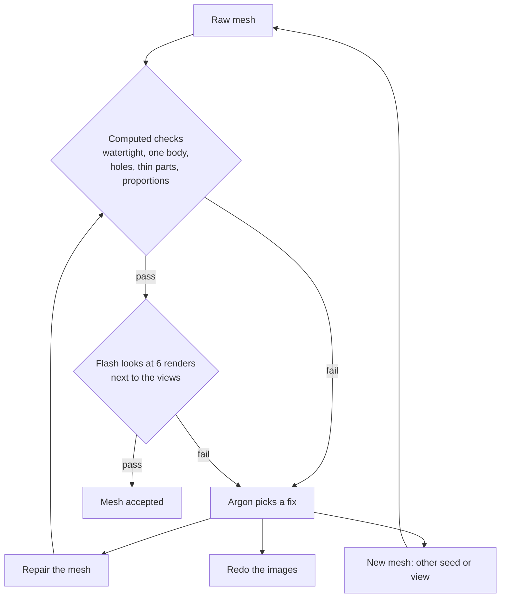
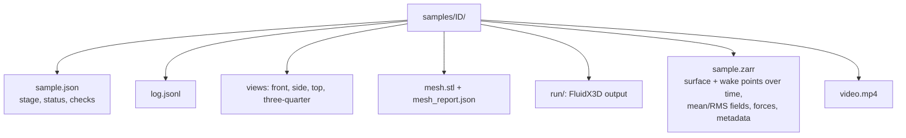
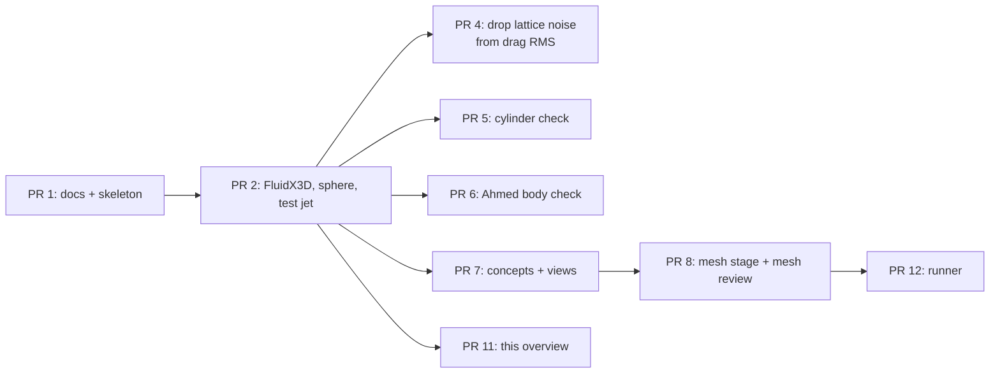
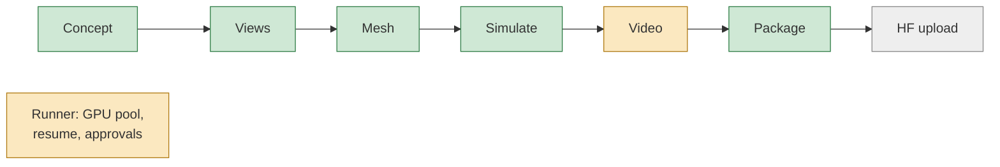

# FlowArc overview

FlowArc builds a CFD dataset with many different shapes. Gemini comes up with objects and draws them, an image-to-3D model turns the drawings into meshes, and FluidX3D simulates the flow around each one. Every stage checks its own output and retries when the check fails.

Status as of 2026-10-24. The build plan is in [PLAN.md](../PLAN.md).

## Pipeline

## What each stage checks

| Stage | Check | Pass when |
|---|---|---|
| Concept | Embedding similarity to every existing sample | below 0.88 |
| Views | Flash compares the 4 views | same object, parts and proportions |
| Mesh | Watertight, one body, no thin parts | thin surface below 1% |
| Mesh | Hole count vs what Argon expects | equal |
| Mesh | Proportions vs the views | within about 30% |
| Mesh | Mirror symmetry (when expected) | Chamfer below 1% of length |
| Mesh | Flash review of mesh renders | see below |
| Mesh | Silhouette vs the views | low bar only (the views don't match each other exactly) |
| Simulate | Mach, mass, drag settled | Mach below 0.3, drag halves within a few % |
| Video | Flash reviews 3 frames (soft check: flags the sample) | body framed, flow visible, no artifacts |

## Mesh review

The generated views don't match each other exactly, so they are only a reference for what the object should be. The main question is whether the mesh itself looks right.

Flash answers pass or fail, with a reason, for each of these:

- Same object as the views, with the same main parts and the same number of each.
- No extra structures: blobs, spikes, loose bits, a base plate, leftover background.
- No parts fused that should be separate, and none missing.
- No holes or dents that shouldn't be there, and real holes are open.
- Clean surface: no lumpy noise, no stair-steps, no collapsed thin parts.
- Upright, front facing the flow.

## One sample on disk

`sample.json` records which stage runs next, so a crashed run picks up where it stopped.

## Solver checks so far

| Case | Result | Reference |
|---|---|---|
| Sphere drag, Re 20 / 100 / 300, 8×4×4 box | +8% / +3% / 0% | Schiller-Naumann curve |
| Sphere shedding, Re 300 | St 0.1375 | 0.137 |
| Cylinder shedding, Re 100 / 150 | St 0.170 / 0.189 | 0.167 / 0.182 (Williamson) |
| Cylinder drag, Re 100 | Cd 1.47 (same at 32 and 48 cells/D) | about 1.33, still open |
| Ahmed body, 25°, Re 4.3e6 | Cd 1.29 → 0.91 (64 → 128 cells/L) | 0.285 |

The solver has no wall model, so drag is only trusted up to about Re 1e5. Samples above that are marked "Re nominal".

## Pull requests

All merged into `main`.

## Where we are

Green works, amber works but needs tuning, grey is not built yet.

First full sample (manta ray, Re 250) ran end to end on one A100 through the runner: 4 min of sim, 0.5 GB packed. Flash now reviews 3 video frames and flagged the first video's framing. The camera now matches the F-35 reference (upstream, above, wake to the upper right), the vortex cut-off rises with Re, and most samples are at Re 1e4–1e5.

Mesh bake-off on 4 objects: Hunyuan3D-2.1 was as good as 2mv or better (2mv lost the aircraft's inner wings), so 2.1 is the default and 2mv the backup.

## Next

1. Runner approvals: before publishing and before going over the GPU-hour budget.
2. Pilot of 10–20 samples, then 100.
3. Upload to a private HF dataset (needs a write token), then delete the copy on RDS.

## Where things live

- Code: this repo. Validation scripts are in `scripts/`.
- w7830: everything under `/remote/rds/users/s1612415/flowarc` (code, FluidX3D builds, Hunyuan weights, validation runs). Nothing outside RDS.
